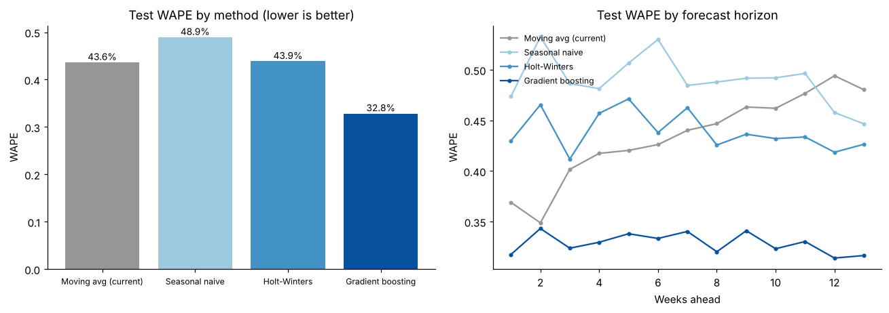
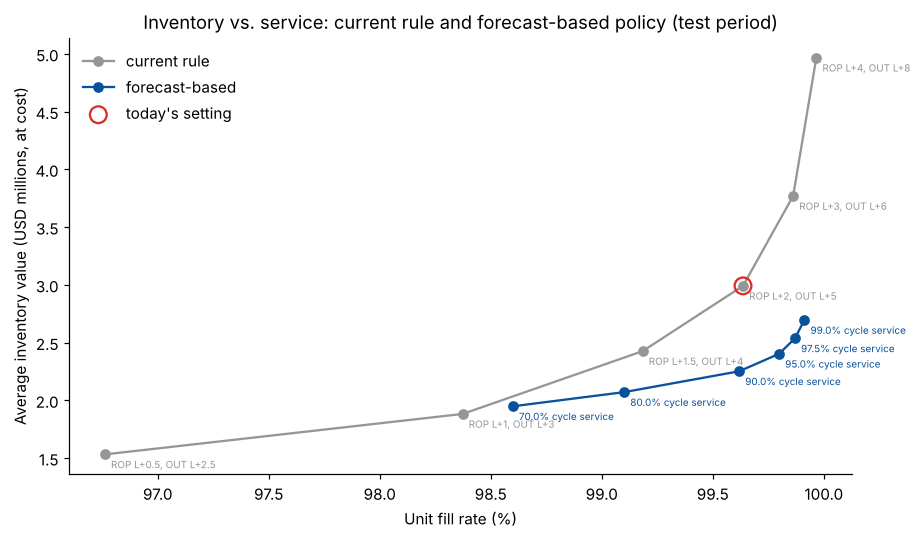
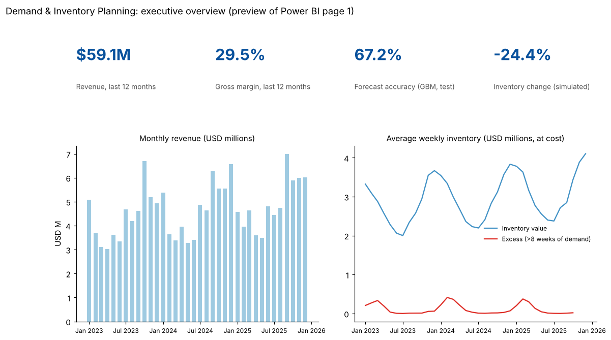

# Retail Demand Forecasting and Inventory Planning

This project forecasts weekly SKU x distribution-centre demand for a packaging distributor and sets
reorder points from measured forecast error instead of a weeks-of-cover rule of thumb. It also
builds a star-schema data mart for a Power BI planning dashboard. All data is synthetic (see
[Note on data](#note-on-data)).

## Business goal

A packaging distributor (boxes, mailers, tape, film, food containers) plans replenishment for 60 SKUs
in 4 distribution centres. Planners forecast with an 8-week moving average in Excel and reorder on a
weeks-of-cover rule. Demand is seasonal and promotion-driven, so this approach leaves excess stock
after peaks and runs short before them. Weekly reporting is assembled by hand from exports.

The project answers three questions:

1. How much more accurate is a seasonal or machine-learning forecast than the current method?
2. How much inventory and excess inventory would a forecast-driven safety-stock policy remove at the
   same or better service level?
3. What data model lets a Power BI report replace the manual weekly Excel pack?

This project is modelled on work I did for a packaging distributor. The analysis there led to an 18%
gain in forecast accuracy, a 12% cut in excess inventory, and a cut in reporting time from about
8 hours to 30 minutes. The numbers below are what this code produces on synthetic data.

## Data

`src/generate_data.py` writes 7 CSVs to `data/raw/`. It covers 156 weeks (2023-01-02 to 2025-12-28)
and uses a fixed seed, so every run gives the same data.

| Table | Rows | Grain | Key columns |
|---|---|---|---|
| `transactions.csv` | 372,082 | order line | order_id, line_no, order_date, customer_id, location_id, sku_id, quantity, unit_price |
| `inventory_snapshots.csv` | 37,440 | SKU x DC x week-end | snapshot_date, on_hand_units, on_order_units, backorder_units |
| `purchase_orders.csv` | 9,764 | replenishment order | po_id, order_date, expected_receipt_date, quantity |
| `promotions.csv` | 321 | SKU promotion window | start_date, end_date, discount_pct |
| `products.csv` | 60 | SKU | category, case_pack, list_price, unit_cost |
| `locations.csv` | 4 | distribution centre | region, lead_time_weeks (1-3) |
| `customers.csv` | 420 | customer | segment, home_location_id, price_tier |

How the generator works:

- **Order lines.** Daily order counts are Poisson. The rate combines a base level, a SKU trend, a
  category seasonality curve, a promotion lift, a weekday pattern and an autocorrelated (AR(1))
  weekly shock. Order sizes are lognormal and rounded to case packs.
- **Seasonality.** Each category has its own curve. The Q4 e-commerce peak drives boxes, mailers and
  void fill. Food containers peak in summer. Gift packaging has a sharp December peak. Labels and
  stretch film are almost flat.
- **Inventory and purchase orders.** These come from simulating the distributor's current rule on
  the realised demand: reorder when inventory position drops below `avg8 x (L + 2)`, and order up to
  `avg8 x (L + 5)`. Here `avg8` is the trailing 8-week average and `L` is the lead time. Orders are
  rounded up to case packs.

The same simulator (`src/inventory.py`) is reused in notebook 03, so the simulated policies can be
checked against the recorded snapshots.

## Approach

1. **EDA and SQL aggregation** (`01_eda_sql_aggregation.ipynb`). The raw tables are loaded into
   in-memory SQLite. SQL with CTEs, a recursive calendar, joins and window functions builds the
   weekly SKU x DC sales table, including zero weeks and promotion flags. The same SQL profiles
   seasonality, YoY growth, SKU concentration, promotion lift, and weeks of cover and excess stock
   under the current rule.
2. **Forecasting** (`02_demand_forecasting.ipynb`). A 13-week-horizon backtest compares four
   methods: an 8-week moving average (current practice), seasonal naive, damped Holt-Winters
   (statsmodels) and a global direct multi-horizon gradient boosting model (scikit-learn
   HistGradientBoosting). The gradient boosting model uses lag levels, last-year same-week demand,
   promotions, calendar and category features. There is one validation origin (week 103) and three
   quarterly test origins (weeks 116, 129, 142, covering 39 weeks). Metrics are WAPE (primary),
   MAPE on non-zero weeks, and bias. The notebook also writes rolling weekly forecasts for
   replenishment and a forward forecast for the next quarter.
3. **Inventory optimization** (`03_inventory_optimization.ipynb`). The safety stock is
   `z x sigma_LT`, where `sigma_LT` is the RMSE of lead-time forecast errors on the validation
   quarter (blended with the category average). The forecast-based policy has reorder point
   `s_t = forecast demand over the lead time + safety stock` and order-up-to `S_t = s_t + 3 weeks of
   forecast demand`. Its order cycle is the same length as the current rule's. Both policies are
   simulated week by week over the 39 test weeks, starting from the real snapshot and open purchase
   orders. The notebook also sweeps service targets and weeks-of-cover settings to compare the two
   policies at equal fill rate.
4. **Dashboard data mart** (`04_dashboard_data_mart.ipynb`). SQL builds a star schema with
   `dim_date`, `dim_product` and `dim_location`, plus 4 facts: sales, inventory, forecast and policy
   simulation. Validation checks cover unique grains, orphan keys, and units and revenue reconciling
   to the raw order lines. The tables are exported to `data/processed/mart/` for Power BI.

## Results

Forecast accuracy on the test period (39 weeks x 240 SKU-DC series, 13-week horizon):

| Method | WAPE | MAPE | Bias | Accuracy (1 - WAPE) |
|---|---|---|---|---|
| 8-week moving average (current) | 43.6% | 62.8% | -13.5% | 56.4% |
| Seasonal naive | 48.9% | 71.3% | +2.0% | 51.1% |
| Holt-Winters (damped, additive seasonal) | 43.9% | 62.7% | -3.2% | 56.1% |
| **Gradient boosting (global, direct)** | **32.8%** | **53.0%** | **-1.6%** | **67.2%** |

- Gradient boosting cuts WAPE by **24.7%** against the current method, which is a **19.1% relative
  gain in forecast accuracy** (56.4% to 67.2%). It wins at every test origin. The gain is largest
  for seasonal categories: WAPE falls 40.8% for Gift Packaging and 28.4% for Food Containers.
- Holt-Winters fitted per series does no better than the moving average on the test quarters. Weekly
  SKU-DC data is too noisy for stable per-series seasonal fits. A global model learns seasonal
  shape across SKUs instead.

Inventory policy simulation (39 test weeks, actual demand, same lead times and case packs):

| Metric | Current rule | Forecast-based, 95% cycle service | Forecast-based, equal fill rate |
|---|---|---|---|
| Avg inventory value (at cost) | USD 2.99M | USD 2.40M (**-19.7%**) | USD 2.26M (**-24.4%**) |
| Avg excess inventory value (stock not needed within 8 weeks) | USD 36.4K | USD 29.8K (**-18.2%**) | USD 29.3K (**-19.5%**) |
| Unit fill rate | 99.64% | 99.80% | 99.63% |
| SKU-DC-weeks with backorders | 1.06% | 0.76% | 1.29% |

The simulator reproduces the recorded snapshots under the current rule to within 0.27 units on
average.







### Power BI dashboard

The report reads the CSVs in `data/processed/mart/`. The relationships are `dim_product[sku_id]`,
`dim_location[location_id]` and `dim_date[week_key]` to each fact table, single direction, dimension
to fact. No `.pbix` is included. The pages are:

1. **Executive overview.** KPI cards for revenue, gross margin %, forecast accuracy and inventory
   value vs. last year. Monthly revenue trend. Inventory value vs. excess. A static preview is
   shown above.
2. **Demand and sales trends.** Weekly units and revenue by category and DC, YoY growth, seasonality
   heatmap, promotion weeks highlighted, and a top-SKU Pareto.
3. **Inventory health.** Weeks of cover distribution, excess value by category and DC, stockout
   (backorder) weeks, and a SKU-DC drill-through table with traffic-light flags.
4. **Forecast performance.** Accuracy (1 - WAPE) and bias by method, category and horizon, with
   forecast vs. actual lines for a selected SKU-DC, and the next-quarter forecast.
5. **Replenishment policy.** Current rule vs. forecast-based simulation: inventory value, fill rate
   and order count over time, with safety-stock parameters per SKU-DC.

Core measures (DAX):

```
Revenue          = SUM(fact_sales_weekly[revenue])
Gross Margin %   = DIVIDE(SUM(fact_sales_weekly[gross_margin]), [Revenue])
Forecast Accuracy =
    1 - DIVIDE(
        SUMX(fact_forecast, ABS(fact_forecast[actual_units] - fact_forecast[forecast_units])),
        SUM(fact_forecast[actual_units]))
Inventory Value  = SUM(fact_inventory_weekly[inventory_value])
Excess Share     = DIVIDE(SUM(fact_inventory_weekly[excess_value]), [Inventory Value])
```

## Repository structure

```
retail-demand-forecasting/
  README.md
  requirements.txt
  data/
    raw/                      synthetic source tables (generated)
    processed/                weekly sales, backtests, rolling forecasts, policy simulation
      mart/                   Power BI star schema + data dictionary
  src/
    generate_data.py          deterministic synthetic data generator
    forecasting.py            baselines, Holt-Winters, direct gradient boosting, metrics
    inventory.py              weekly replenishment simulator (current rule and forecast policy)
  notebooks/
    01_eda_sql_aggregation.ipynb
    02_demand_forecasting.ipynb
    03_inventory_optimization.ipynb
    04_dashboard_data_mart.ipynb
  reports/figures/            charts saved by the notebooks
```

## How to reproduce

```bash
pip install -r requirements.txt
python src/generate_data.py
cd notebooks
jupyter nbconvert --to notebook --execute --inplace 01_eda_sql_aggregation.ipynb
jupyter nbconvert --to notebook --execute --inplace 02_demand_forecasting.ipynb
jupyter nbconvert --to notebook --execute --inplace 03_inventory_optimization.ipynb
jupyter nbconvert --to notebook --execute --inplace 04_dashboard_data_mart.ipynb
```

Run the notebooks in order, because each one reads the previous one's outputs from
`data/processed/`. Notebook 02 takes about a minute; the others take a few seconds.
`python src/generate_data.py --scale 2` generates about twice the order volume. The transactions
file will then be larger than 20 MB.

## Tech stack

Python 3, pandas, NumPy, SQLite (SQL with CTEs and window functions), statsmodels (Holt-Winters),
scikit-learn (HistGradientBoostingRegressor, permutation importance), SciPy, Matplotlib, Jupyter.
Power BI is the dashboard target.

## Note on data

All data in this repository is synthetic, generated by `src/generate_data.py`. Company names,
SKUs, customers and locations are fictional. No client data is included. The generator plants
realistic structure (seasonality, trends, promotions, an incumbent replenishment rule) so the
methods can be shown end to end. The results describe this synthetic dataset and are not
measurements from a real business.
